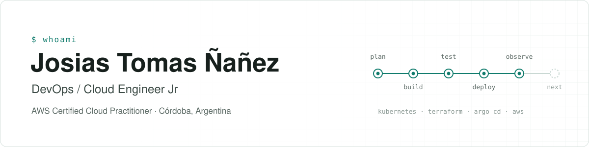

<picture>
  <source media="(prefers-color-scheme: dark)" srcset="assets/header-dark.svg">
  
</picture>

Trabajo con **Kubernetes**, **GitOps con Argo CD**, **CI/CD con GitHub Actions** y **Terraform sobre AWS**. Me enfoco en automatizar, monitorear y dejar sistemas que funcionen solos. Busco mi primer rol formal como DevOps o Cloud Engineer.

### En producción

**Consultor IT freelance · Casa Fioretti** (desde sept. 2026)

- Odoo Enterprise on-premise para ~20 dispositivos: Linux con discos cifrados, Docker y configuración como código con Makefile. Acceso por Tailscale y Cloudflare Access.
- Monitoreo como código en Grafana (servidor, PostgreSQL y Odoo), con alertas por email y Discord.
- Backups diarios a Cloudflare R2 y disco local, con chequeo semanal y restore simulado una vez por mes.
- Turnero para red local que atiende 7 puestos y ~300 clientes por día.

### Proyectos

| Proyecto | Qué tiene |
|---|---|
| **[FinFlow](https://github.com/JosiasTomasnanez/FinFlow)** | Plataforma GitOps sobre K3s y Amazon EKS: Helm, Argo CD (app-of-apps), canary con Argo Rollouts, autoescalado con KEDA, observabilidad con Prometheus, Grafana, Loki y Jaeger, Sealed Secrets y quality gate en GitHub Actions. Proyecto grupal de la Diplomatura; fui el autor principal de la infraestructura. |
| **[VitalMed](https://github.com/JosiasTomasnanez/vitalmed-telehealth-platform)** | Arquitectura AWS multi-cuenta en Terraform modular (VPC, ECS Fargate, Aurora, Lambda + SQS, CloudFront). Escribí los 32 tests de Terraform y el pipeline de CI (validate, TFLint, Checkov). |

Otros proyectos de la facultad: [shell en C](https://github.com/JosiasTomasnanez/custom_shell) · [gestor de memoria en C](https://github.com/JosiasTomasnanez/custom_memory_manager) · [monitor de métricas del sistema](https://github.com/JosiasTomasnanez/metrics_monitor) · [concurrencia con redes de Petri](https://github.com/JosiasTomasnanez/flightAgencyAttendanceMonitor) · [SatisPlanning](https://github.com/JosiasTomasnanez/SatisPlanning-game)

### Stack

  

También: Helm · Argo CD · Argo Rollouts · KEDA · Loki · Jaeger · Sealed Secrets · SonarCloud · OWASP ZAP · Checkov · TFLint · Cloudflare (R2, Access) · Tailscale

### Certificaciones y comunidad

- **AWS Certified Cloud Practitioner** (2026)
- **Diplomatura en DevOps**, FCEFyN, Universidad Nacional de Córdoba (2026)
- **Core Team Member, AWS Student Builder Group UNC**: contenido open source (roadmaps de DevOps y Git)

### Contacto

[LinkedIn](https://www.linkedin.com/in/josias-tomas-%C3%B1a%C3%B1ez-5771a0319) · josias.tomas.kiara@gmail.com
